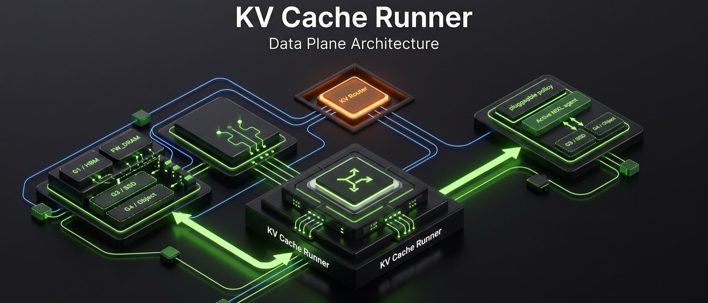
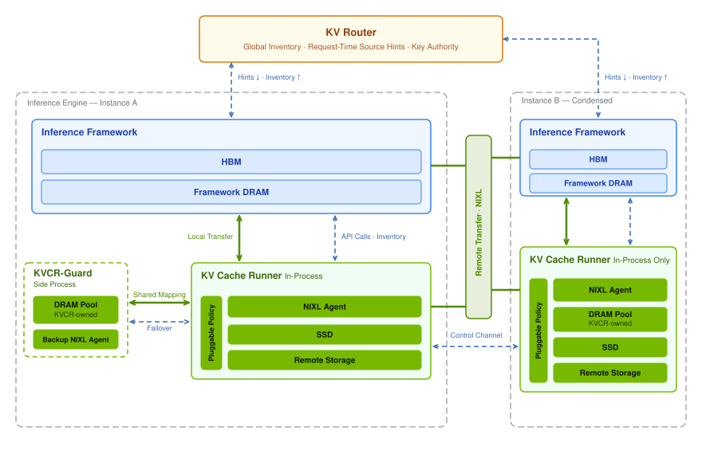

<p align="center">
  
</p>

> [!NOTE]
> **Initial release (experimental).** KVCR supports cross-node DRAM sharing, local disk caching,
> and resiliency for vLLM. Future releases will add SGLang and TRT-LLM integrations
> and object storage support.
>
> Feedback and contributions are welcome - see [CONTRIBUTING.md](CONTRIBUTING.md).

# KV Cache Runner

Modern AI workloads require KV cache infrastructure that delivers speed, scale,
and resilience.

KV Cache Runner (KVCR) reimagines KV cache as a system-wide distributed
resource: available across memory and storage tiers, resilient by design, and
managed holistically to unlock system-level optimizations and maximize
end-to-end performance.

KVCR is agentic-native and built to accelerate AI workloads of every kind.

## Architecture

KVCR is at its most powerful when working in tandem with a KV-aware request
router. The router knows where the KV cache resides and can provide the selected
worker with hints about where to retrieve it. The cache can be sourced locally
or from remote peers, within or across memory and storage tiers, or from any
combination of these sources.

KVCR leaves local KV cache offloading to host memory under the engine's control.
It focuses on system-level optimizations enabled by this architecture, including
cross-node KV cache sharing, KV-aware request load balancing, and KV cache
prefetching — all guided by the router’s system-wide view. By maximizing KV cache
reuse and overlapping cache onboarding with computation, KVCR reduces redundant
work and improves prefill efficiency.

KVCR is resilient by design. KVCR-Guard is a sidecar KVCR process operating in
active-passive mode and can outlive an engine failure. In such an event,
KVCR-Guard remains available as a remote source of KV cache, minimizing
disruption to serving in the face of failures.

KVCR provides a flexible policy interface that allows its behavior to be
customized for different workloads.

<picture>
  <source media="(prefers-color-scheme: dark)" srcset="docs/figures/kv-architecture-dark.svg">
  <source media="(prefers-color-scheme: light)" srcset="docs/figures/kv-architecture-light.svg">
  
</picture>

For more details, see the [design document](docs/design_overview.md).

- `kvcr.api`: Contains the user-facing API for configuring KVCR and interacting
  with its core.
- `kvcr.policy`: Contains the policy interface for customizing KVCR's behavior
  for different workloads.

## Framework support

KVCR is vendor and framework agnostic, with no dependency on a specific request
router. The list below summarizes framework integrations that are complete or
in progress. We plan to extend support to additional frameworks and routers in
the future.

### KV Hint Protocol

- TRT-LLM
  - [[RFC] Versioned KV Hints Protocol for TRT-LLM #18153](https://github.com/NVIDIA/TensorRT-LLM/issues/18153)

- vLLM — supported
  - Additional features tracked in [RFC #59708](https://github.com/vllm-project/vllm/issues/59708).

- SGLang — supported
  - Additional features tracked in [RFC #36224](https://github.com/sgl-project/sglang/issues/36224).

- Dynamo KV Router — supported

### Engine support

- TRT-LLM
  - [[RFC]: Router Hint initiated P2P KV Cache Transfer Between TRT-LLM Workers #18151](https://github.com/NVIDIA/TensorRT-LLM/issues/18151)
  - [Router Hint initiated P2P KV Cache Transfer Between TRT-LLM Workers #18158](https://github.com/NVIDIA/TensorRT-LLM/pull/18158)

- vLLM — supported

- SGLang
  - [[RFC] KVCR as a HiCacheStorage backend for peer-to-peer KV reuse #32903](https://github.com/sgl-project/sglang/issues/32903)
  

### Routers

- [Dynamo KV Router](https://docs.nvidia.com/dynamo/dev/knowledge-base/modular-components/router/overview)
- [sgl-router](https://github.com/sgl-project/sglang/tree/main/experimental/sgl-router)
- [llmd-router](https://llm-d.ai/docs/dev/architecture/core/router)

## Using KVCR

### Quick start

The [quick start](docs/quick-start.md) is a public preview that builds and runs
KVCR with vLLM, Dynamo, and NIXL using pinned source revisions and a compatible
base image. See the
[developer guide](docs/dev-guide.md#integrate-with-vllm-and-dynamo-optional)
for source installation and verification.

### Development

For local development, API lifecycle guidance, validation, integration, and
KVCR guard service usage, see the [developer guide](docs/dev-guide.md).

### Direct GPU memory endpoints

An opt-in `RemoteFWGPUOptions` endpoint delivers framework-owned CUDA buffers
without allocating or falling back to CPU or disk payload storage in KVCR:

```python
from kvcr.config import KVCRBackendConfigs, RemoteFWGPUOptions
from kvcr.types import RegionDescriptor

backend = KVCRBackendConfigs(
    framework_regions=[
        RegionDescriptor(
            mem_type="VRAM", device_Id=cuda_device, addr=allocation_address,
            size=bytes_per_block, stride=block_stride, count=block_count,
        ),
    ],
    remote_fw_gpu=RemoteFWGPUOptions(compatibility_domain=compatible_layout_domain),
)
```

Use a separate instance and control endpoint from the CPU path. All registrations
must be VRAM; `local_dram`, G3 and Guard pools are rejected. The instance accepts
only `kv.fetch_gpu@1.0`, with explicit `source_memory_kind="gpu"`,
`target_memory_kind="gpu"`, `transport="nixl_gpu_direct"` and a matching
`compatibility_domain`. Its `deliver()` writes into caller-reserved VRAM and its
query tier is `REMOTE_G1`; `fetch()` and `deposit()` managed-storage APIs are
unavailable. Ordinary `kv.fetch` CPU endpoints retain their existing behavior.
Before offering destination memory, each GPU delivery performs an operation-bound
metadata handshake with the exact source endpoint and GPU contract. Legacy,
mismatched or silent peers fail before any writable destination descriptors or
native peer connection are exposed; they do not create a target write hazard.

The initial transport policy is **same-host CUDA IPC only**, with
`UCX_TLS=cuda_ipc,posix,self` set before starting either process. The explicit
allowlist also permits `sysv` for host control metadata, but excludes TCP, CUDA
copy, GDR copy, aliases and network transports. Native UCX must support VRAM.
This policy is checked before native initialization; actual CUDA IPC usability
and no-host-staging behavior still require GPU transport qualification. Cross-node
GPUDirect RDMA is not enabled by this implementation.
Set `NIXL_UCX_CUDA_IPC_ONLY=1` as well, with a NIXL UCX plugin that implements
this strict policy and verifies initialized CUDA memory support. GPU endpoint
startup rejects a missing policy flag; it does not enable CUDA copy to work
around a native initialization failure.
The experimental [native dependency patches and build contract](docs/gpu-direct-native-dependencies/README.md)
pin the NIXL/UCX source changes required by this profile. They are separate from
the KVCR wheel and do not establish compatibility with arbitrary native builds.

GPU-only instances initialize UCX explicitly with the supported
`ucx_error_handling_mode=none` option. The same-host IPC transports cannot
provide UCX's native peer-error handling; ordinary CPU instances retain their
existing backend defaults. The actual initialized option is checked before
VRAM registration. This profile does **not** promise native peer-death recovery:
deadlines do not cancel native writes or make destination slots reusable.
Uncertain operations retain their pins and GPU allocations until actual native
completion/quiescence, and a transport failure can still terminate the process.
No TCP or host-copy fallback is added to obtain peer-error handling.

The framework must fence producer writes before returning a GPU pin result and
retain the entire registered allocation until quiescent shutdown. Source block
pins are held through native completion, including timeout/cancellation grace
expiry. Destinations must stay reserved until successful completion or a
quiesced failure: an uncertain `TransferError` requires quarantine, and a late
native completion does not make canceled data valid. GPU-mode failed results
are withheld until destination writes are quiesced; `abort()` currently returns
false and callers must continue draining completions. KVCR does not synchronize
framework CUDA streams or manage GPU block allocation. The ordinary P-to-D NIXL
handoff is separate from this D-to-P endpoint.

## License

KVCR is released under the Apache License 2.0. The full license text is in
[LICENSE](LICENSE).

KVCR package source files carry an SPDX Apache-2.0 identifier and the NVIDIA
copyright notice. The vLLM source files used in the public quick-start
build retain their Apache-2.0 contributor headers.

## Third-party software

vLLM and Dynamo are installed separately in the quick-start image and are not
bundled into the `kvcr` wheel. The build uses the public sources and
pinned revisions described in the [quick start](docs/quick-start.md).

KVCR declares runtime dependencies on `msgspec`, `pyzmq`, and `nixl`. Each is
installed from its own distribution under its own license. None of them are
redistributed by this repository or bundled into the `kvcr` wheel, which
packages only `src/kvcr`.

## Contributing

This project accepts external contributions. See
[CONTRIBUTING.md](CONTRIBUTING.md) for the workflow.

Contributions require a Developer Certificate of Origin sign-off
(`git commit -s`), whose full text is reproduced in that file and which is
enforced on every pull request by the `dco` CI workflow. Participation is
governed by [CODE_OF_CONDUCT.md](CODE_OF_CONDUCT.md).

To report a security vulnerability, do not open a public issue — follow
[SECURITY.md](SECURITY.md).
