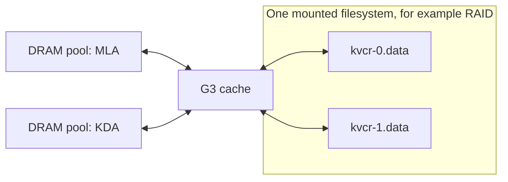

<!--
SPDX-License-Identifier: Apache-2.0
SPDX-FileCopyrightText: Copyright (c) 2026 NVIDIA CORPORATION & AFFILIATES. All rights reserved.
-->

# Multi-pool G3 example

[`g3_multi_pool.py`](g3_multi_pool.py) exercises KVCR's native file transfers
without loading model weights. A cache key can contain pieces from several
DRAM pools. G3 stores every piece and retains its pool label and file locations
so it can restore the key into the correct buffers.

A DRAM pool is a named memory region containing fixed-size slots. Different
pools can have different slot sizes. All pools share the configured G3 files;
there is no required mapping from a DRAM pool to a particular file or SSD.



The filesystem and RAID/block layer manage physical drives. This feature uses
G3's existing file-slot mapping and adds no SSD placement policy.

## Recommended storage deployment

For a rebuildable local G3 cache using several SSDs, we recommend RAID0 with a
filesystem supporting direct I/O. Choose the layout for the host topology:

| Layout | Mounts | Placement |
| --- | --- | --- |
| One RAID0 volume across the selected SSDs | One mount, such as `/mnt/kvcr` | Put the instance's G3 files on this mount. This is the simplest deployment; a volume spanning NUMA domains may use cross-domain I/O paths. |
| One RAID0 volume per NUMA domain, using SSDs local to that domain | Separate mounts, such as `/mnt/kvcr-numa0` and `/mnt/kvcr-numa1` | Configure each KVCR instance's files on the mount closest to its DRAM buffers and GPU, where applicable. This provides best-effort locality. |

For the NUMA layout, align worker and I/O-thread CPU affinity and DRAM/staging
memory placement with the selected domain. Apply memory placement where the
buffers are allocated, including the Guard service when it owns the pools.
For GPU I/O, also inspect GPU-to-NVMe PCIe affinity. A mount path alone does
not bind CPUs or memory, and a DRAM pool name does not identify a NUMA domain.

KVCR currently allocates across all configured G3 paths without a NUMA
preference. To preserve the intended locality, give an instance paths from
its selected mount. Listing files from both NUMA mounts in one instance does
not provide automatic local-first allocation. Separate instances can share
a mount using distinct, exclusively owned cache files. Automatic topology
selection and cross-domain placement remain outside this change.

One or more G3 files can live under each selected mount; the filesystem and
RAID layer stripe their contents across that volume's SSDs. Operators provision
the arrays and mounts before starting KVCR. RAID0 has no redundancy, so use
this recommendation for cache data that can be regenerated after storage loss.

This deployment recommendation follows the topology considerations in the
[NVIDIA GDS configuration guide](https://docs.nvidia.com/gpudirect-storage/configuration-guide/index.html).
See also the [Linux RAID documentation](https://docs.kernel.org/admin-guide/md.html).
Measure throughput and serving latency on the target topology and file backend;
the local probe runs documented below have not validated RAID0 or NUMA locality.

## Prerequisites

- Linux, Python 3.10+, and a KVCR development installation. From the repository
  root, run `uv sync`; see the [developer guide](../docs/dev-guide.md).
- A NIXL build with UCX and the POSIX plugin, including liburing support.
- A writable directory on a filesystem supporting direct I/O. To test files
  on RAID, use a directory on an already-mounted RAID filesystem.
- A runtime permitting `io_uring_setup`, `io_uring_enter`, and
  `io_uring_register`. Docker needs a seccomp profile permitting these calls;
  see [Running in Docker](#running-in-docker).

The default synthetic POSIX probe needs neither vLLM nor GPU buffers. The
optional Kimi profile requires compatible vLLM and Torch installations.

## Run from the repository root

Start with one file on the local filesystem:

```bash
uv run python examples/g3_multi_pool.py --directory /tmp
```

To exercise three files on an existing RAID mount:

```bash
uv run python examples/g3_multi_pool.py --files 3 --directory /mnt/raid
```

Replace `/mnt/raid` with your writable mount path. The probe creates a fresh
temporary subdirectory and removes only its own test files when it finishes.
It does not create or configure a RAID array.

The default profile uses two pools: `full` with two memory pages per slot and
`swa` with one page per slot. Each key contains `full`, `swa:a`, and `swa:b`.

For Kimi-derived MLA and KDA snapshot sizes:

```bash
uv run python examples/g3_multi_pool.py --profile kimi-k3 --files 3 --directory /mnt/raid
```

The Kimi profile was verified with vLLM `0.31.1rc1.dev23+g43b4aaea3`. It uses
vLLM's cache-spec and state-shape calculators with TP=1, 64-token BF16 MLA
blocks, BF16 convolution state, FP32 recurrent state, and no speculative
decoding or RecoverSSM. The resulting per-layer pieces are 73,728 bytes for
MLA and 6,512,640 bytes for KDA. See the pinned
[model configuration](https://huggingface.co/moonshotai/Kimi-K3/blob/f831ab66814297da540d832a5235f8e904f29d06/config.json).

To select GDS_MT explicitly, in an environment with working CUDA/cuFile and
the NIXL GDS_MT plugin:

```bash
uv run python examples/g3_multi_pool.py --backend GDS_MT --files 3 --directory /mnt/raid
```

## What the probe verifies

1. Deposit two keys into DRAM pools sized for one key, forcing the first to G3.
2. Check that payload was written to the expected files.
3. Deliver the first key from G3 into primary buffers and compare every byte.
4. Refill the DRAM pools from G3, compare every byte, and release the read claim.

For three files, the output includes:

```text
Backend: POSIX; options: {'use_uring': 'true'}
Files: 3; directory: ...
1. Deposited two keys: first spilled from DRAM to G3.
   Confirmed written payload in 3/3 files.
2. Read G3 into primary buffers: every piece matches.
3. Refilled DRAM pools from G3: all bytes match.
PASS: multi-pool DRAM -> G3 -> primary / DRAM round trip.
```

## Configure G3 in an integration

```python
from pathlib import Path

from kvcr.config import G3Options

g3 = G3Options(
    paths=(Path("/mnt/raid/kvcr-0.data"), Path("/mnt/raid/kvcr-1.data")),
    capacity_bytes_per_file=1024**3,
    backend="POSIX",
    backend_options={"use_uring": "true"},
)
```

Pass this object as `KVCRBackendConfigs.g3`. The integration also supplies
`KVCRConfig.pool_layouts`, registered framework regions, `LocalDramOptions`,
and framework bindings. The runnable example shows their construction.

The backend default changes from `GDS_MT` to `POSIX` with io_uring in this
change. Deployments relying on the previous default should explicitly set
`backend="GDS_MT"` to retain their file backend.

- Omitting `backend` selects `POSIX`; omitting POSIX engine options enables
  `use_uring="true"`. Values in `backend_options` are strings.
- Explicit `backend_options={"use_aio": "true"}` selects Linux AIO. Other
  POSIX tuning options preserve the io_uring default.
- Explicit `backend="GDS_MT"` selects GDS_MT without injecting POSIX options.
- One file plugin is selected for the G3 instance and all its files.
- `capacity_bytes_per_file` applies to each file. KVCR preallocates that
  budget rounded down to complete allocation units; the probe itself chooses
  a small per-file budget sufficient for two complete keys across all files.
- Each pool's block size must be memory-page aligned. The allocation unit is
  the greatest common divisor of those sizes; a piece can occupy several units.

For example, 8 KiB `full` blocks and 4 KiB `swa` blocks use 4 KiB disk units.
An entry with layout `["full", "swa:a", "swa:b"]` occupies four units: two for
`full` and one for each `swa` piece. All pools share the configured files.

### Layout and recovery compatibility

The public `deposit`, `fetch`, and `deliver` signatures and configuration fields
are unchanged. Incremental deposits declare the complete `expected_layout`
before supplying pieces; without a declaration, the supplied pieces define a
complete deposit. A deposit for an existing G3 key must match its stored layout.
Multi-pool fetches supply the complete ordered `expected_layout`; deliveries
can select unambiguous labeled pieces using their destination `MemoryRef`s.

Recovery metadata now includes the ordered layout and all disk slots. New
readers accept legacy single-slot records; older readers discard extended G3
records instead of treating one piece as a complete entry. Recovery initially
requires the same model and compatible pool/file configuration. This change
does not add file-content validation or change existing native-error quiescence
handling.

## Running in Docker

Build or reuse the [quick-start image](../docs/quick-start.md#1-build-the-integration-image).
Create a seccomp profile from the default for your Docker version, additionally
allowing the three io_uring syscalls listed above. The
[NIXL POSIX guide](https://github.com/ai-dynamo/nixl/blob/main/src/plugins/posix/README.md)
describes the profile change. The command below applies it only to the test
container.

Set the two paths to your existing mount and seccomp profile, then run from
the repository root:

```bash
export KVCR_G3_DIRECTORY=/mnt/raid
export KVCR_SECCOMP_PROFILE=/absolute/path/to/seccomp-with-uring.json

docker run --rm --network none \
  --user "$(id -u):$(id -g)" \
  --security-opt "seccomp=$KVCR_SECCOMP_PROFILE" \
  --mount "type=bind,src=$PWD,dst=/workspace,readonly" \
  --mount "type=bind,src=$KVCR_G3_DIRECTORY,dst=/g3" \
  -e PYTHONPATH=/workspace/src \
  --entrypoint python3 kvcr-quick-start:local \
  /workspace/examples/g3_multi_pool.py --files 3 --directory /g3
```

io_uring initialization fails if liburing support or syscall permissions are
missing. Choose an explicit supported engine when needed; KVCR does not
silently switch engines. GDS_MT additionally needs GPU/CUDA/cuFile setup.

## Scope and limitations

Validation at runtime commit `d936f3f`, based on upstream `89413ba`: all 689
collected pytest tests passed, as did lint and formatting. Native Kimi-derived
round trips passed with POSIX/io_uring and GDS_MT across three files. A separate
synthetic multi-pool round trip also passed across two filesystem mounts.

- The probe checks cache bytes using synthetic data. Full hybrid-model serving
  still requires the vLLM adapter to export every required pool and piece.
- Serving-group packing, cache dtype, tensor parallelism, and recurrent
  checkpoint eligibility can change the exported layout.
- Some packed DeepSeek V4 layouts have non-page-aligned sizes and need an
  additional layout/padding solution before this G3 path can accept them.
- The two tested ext4 mounts are partitions on the same NVMe device. RAID0,
  NUMA locality, and GPU-to-storage DMA performance were not validated. GDS_MT
  probes used DRAM buffers with cuFile compatibility mode allowed.
- The separate vLLM serving E2E test requires two visible GPUs; it was not run
  on the single-GPU validation node.
- Descriptor and recovery-metadata costs grow with disk units per key. The
  pinned Kimi-derived profile uses a 24 KiB unit and 268 descriptor pairs for
  two pieces; serving performance needs separate measurement.

For configuration, recovery behavior, and integration details, see the
[developer guide](../docs/dev-guide.md). For allocator, layout, recovery,
and failure regression coverage, run:

```bash
uv run python -m pytest tests/unit/test_g3.py tests/unit/test_recovery_journal.py -q
```
